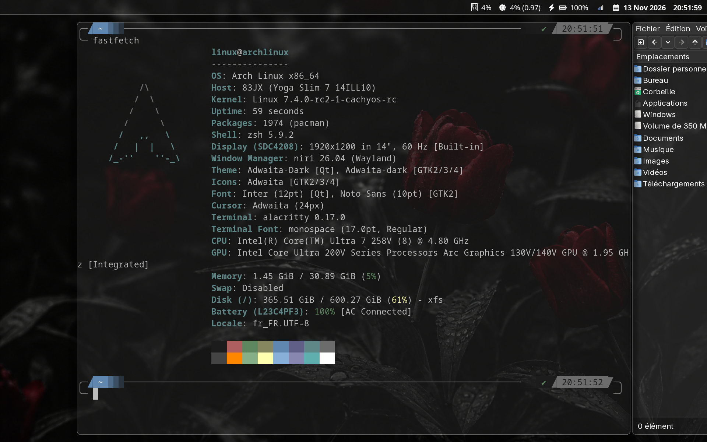
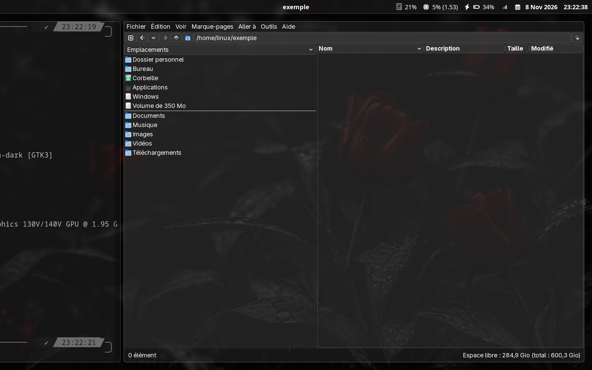
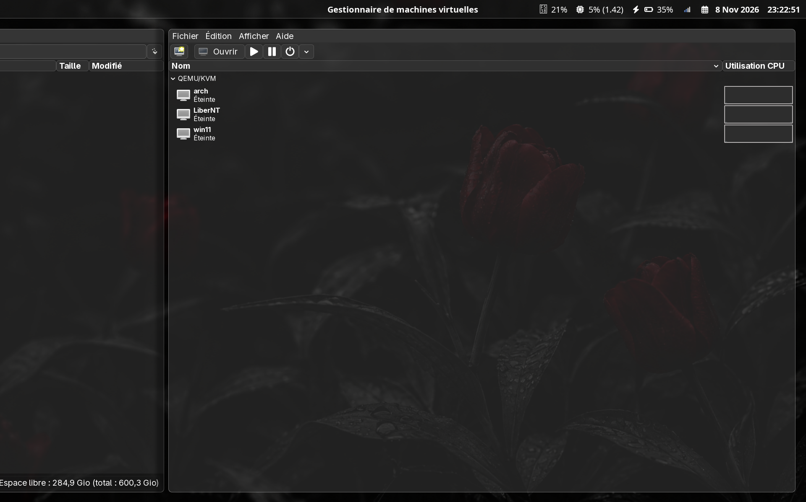

# Dotfiles

Personal desktop setup for [niri](https://github.com/YaLTeR/niri) on Wayland, with Alacritty, Rofi, Waybar, and GTK styling.

## Screenshots

Alacritty with the Waybar status bar:



PCManFM with the translucent dark GTK theme:



virt-manager:



## Install

This installer targets Arch Linux and Arch-based distributions. Update the system first, then run it from this directory:

```
sudo pacman -Syu
./install.sh
```

The script installs the packages used by the configs and links each config directory into `$XDG_CONFIG_HOME` (defaults to `~/.config`). Existing config directories are moved beside the new links with a `.bak-` timestamp suffix; they are never merged or overwritten.

Every package comes from the official Arch repositories, including `niri`. To create the links without installing packages, run:

```
./install.sh --no-deps
```

Set `XDG_CONFIG_HOME` to use another config directory:

```
XDG_CONFIG_HOME="$HOME/.config-test" ./install.sh
```

Then log in through a display manager that lists niri, or start `niri-session` from a TTY.

## Packages

The installer covers the applications and commands referenced by the configs:

| Purpose           | Packages                                                                                                      |
| ----------------- | ------------------------------------------------------------------------------------------------------------- |
| Desktop           | niri, Alacritty, Rofi, Waybar, Mako, GTK 3/4, `xwayland-satellite`, XWayland, `xdg-desktop-portal-gnome`       |
| Apps              | Firefox, PCManFM, Code - OSS, virt-manager                                                                    |
| Capture and media | `swaybg`, `swayidle`, `swaylock`, `grim`, `slurp`, `wf-recorder`, `wl-clipboard`, `brightnessctl`, `playerctl`, WirePlumber, `psmisc` |
| System tray       | NetworkManager applet, Blueman, BlueZ, `lxqt-policykit`, D-Bus                                                |
| Fonts and paths   | JetBrainsMono Nerd Font, Adwaita cursors, `glib2`, `xdg-user-dirs`                                            |

## What's included

| Directory              | Contents                                                          |
| ---------------------- | ----------------------------------------------------------------- |
| `alacritty/`           | Terminal colors, font, and key bindings                           |
| `gtk-3.0/`, `gtk-4.0/` | Dark GTK settings and CSS                                         |
| `niri/`                | Compositor config (`config.kdl`), helper scripts, and wallpaper   |
| `rofi/`                | Launcher settings and the `grey-white` theme                      |
| `screenshots/`         | Images used in this README                                        |
| `waybar/`              | Status bar modules and styles                                     |

## Notes

- Alacritty and Rofi use JetBrainsMono Nerd Font, which also provides the Waybar icons. The package is installed by the script.
- niri uses a French keyboard layout and the wallpaper in `niri/wallpaper/`. Change `layout` in `niri/config.kdl` to use another layout.
- The `output "eDP-1"` block in `niri/config.kdl` targets a laptop screen at 1920x1200. Run `niri msg outputs` to get your own output name and mode, then edit or remove that block.
- The cursor theme is `MacTahoe-light`, which the installer does not provide. niri falls back to its default cursor when the theme is missing; change `xcursor-theme` in `niri/config.kdl` to use another one.
- `niri/scripts/` holds the helpers launched by the config: the GTK dark theme setup, the session environment export used by the desktop portals, and the rofi power menu (`Mod+P`).
- `Mod+S` saves area screenshots in `~/Images` and `Print` records the screen to `~`. Edit the binds in `niri/config.kdl` if your folders are named differently.
- The network and Bluetooth applets need their system services. Enable NetworkManager or Bluetooth only if you use them; the installer does not change service state.
- Volume shortcuts use `wpctl`. They need PipeWire with WirePlumber; the installer provides the client command without replacing your audio server.
- X11 applications run through `xwayland-satellite`, which niri starts on demand.
- The file manager, browser, editor, and virtual machine manager are launched by niri key bindings. Remove or change those bindings in `niri/config.kdl` if you do not use them.
- Arch's `code` package provides Code - OSS. The Microsoft-branded Visual Studio Code build is a separate AUR package ([ArchWiki](https://wiki.archlinux.org/title/Visual_Studio_Code)).

## License

See [LICENSE](LICENSE).
